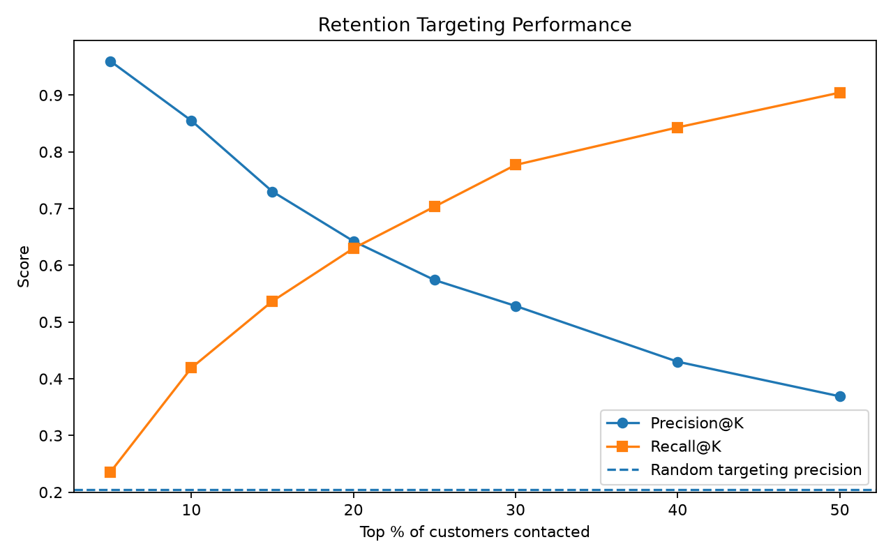
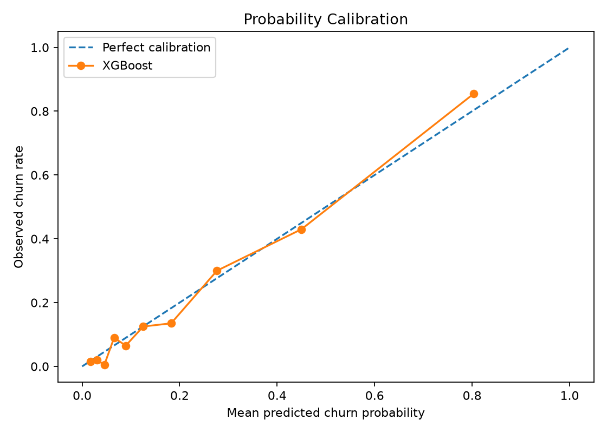
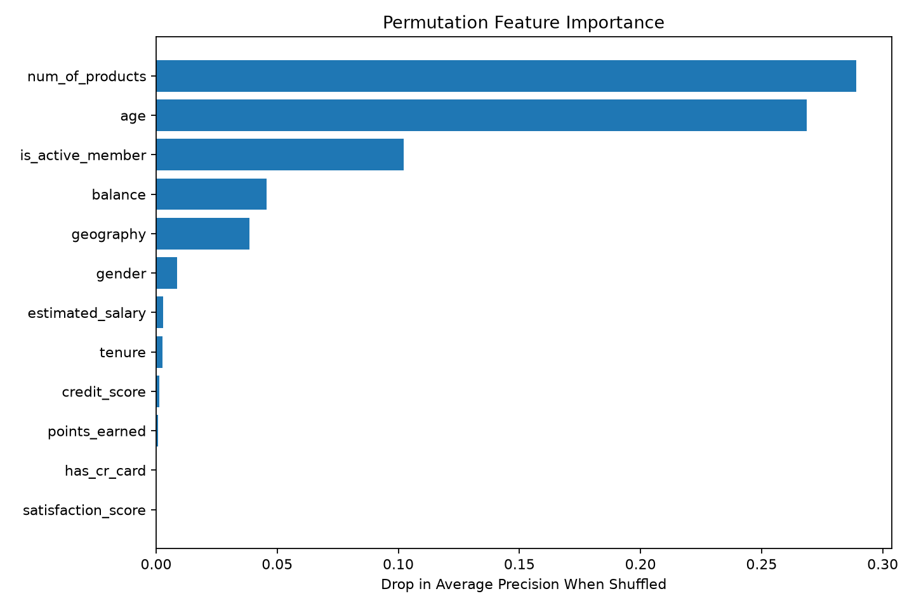
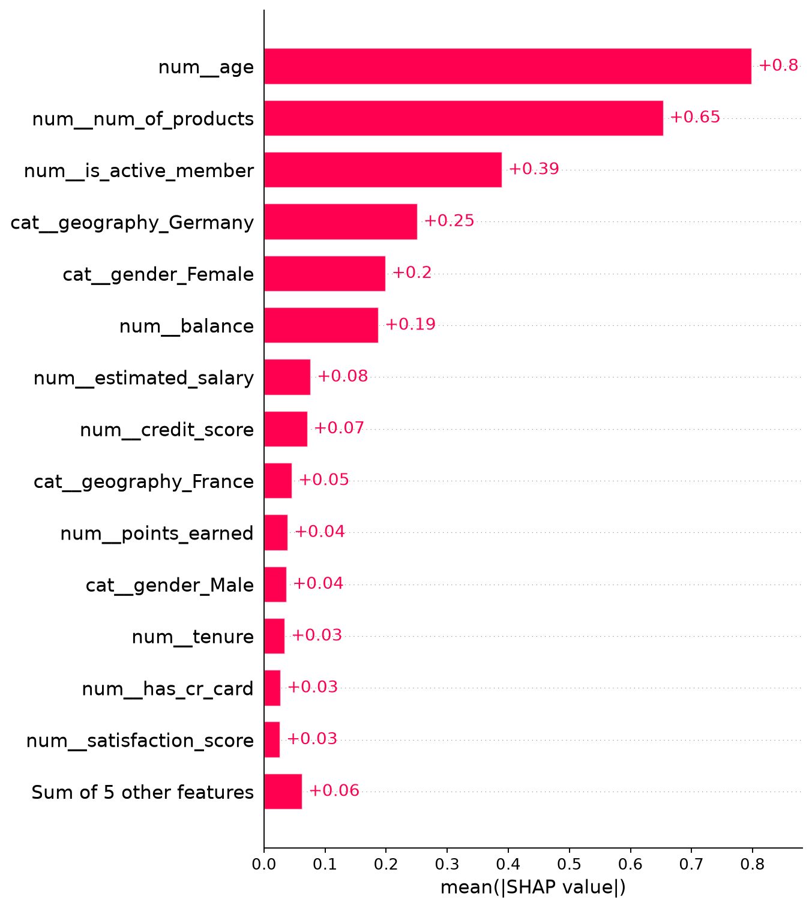
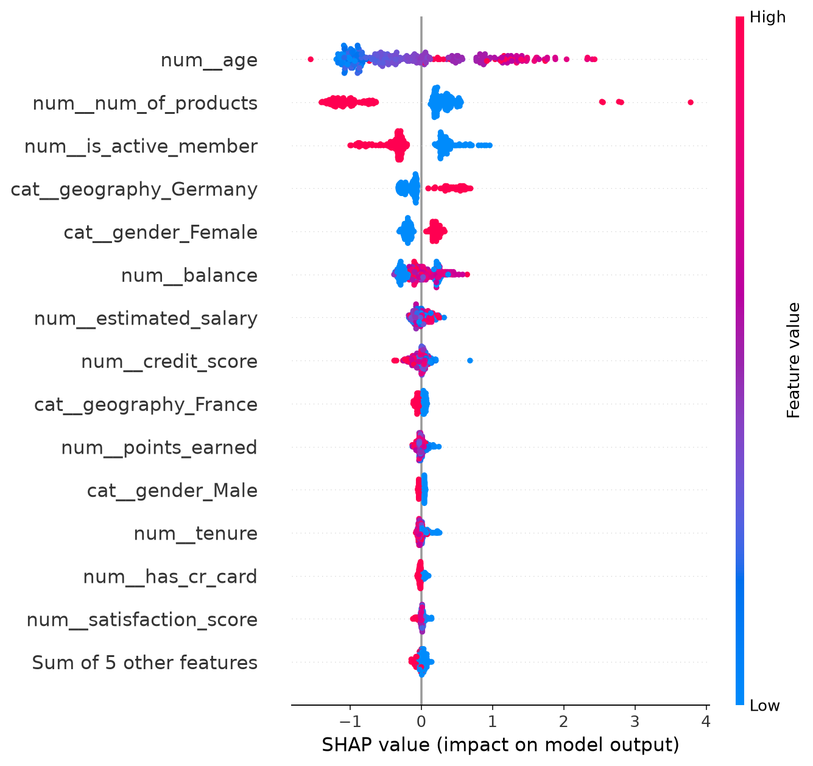
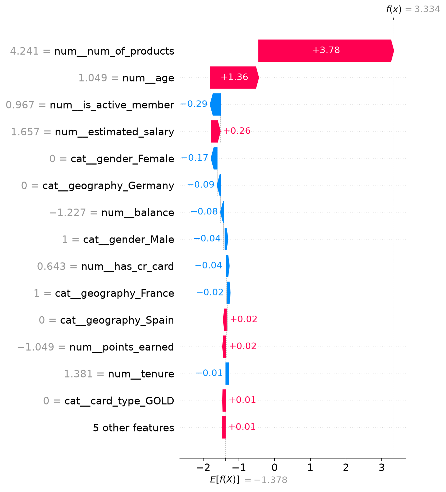
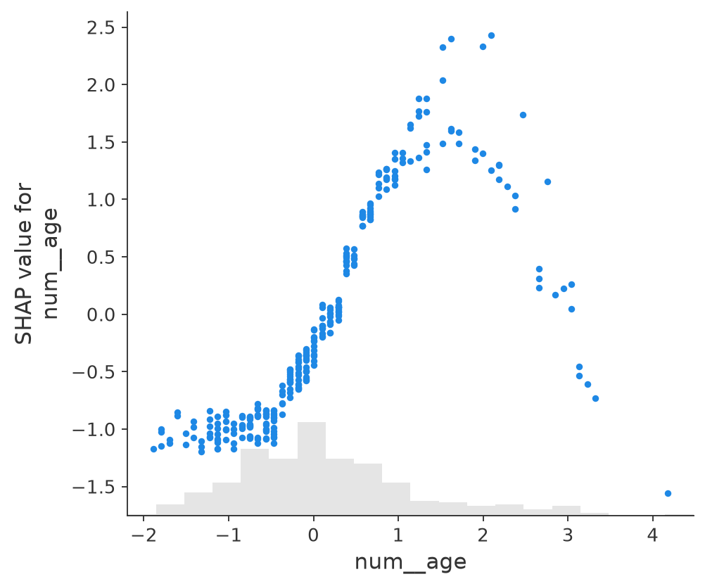
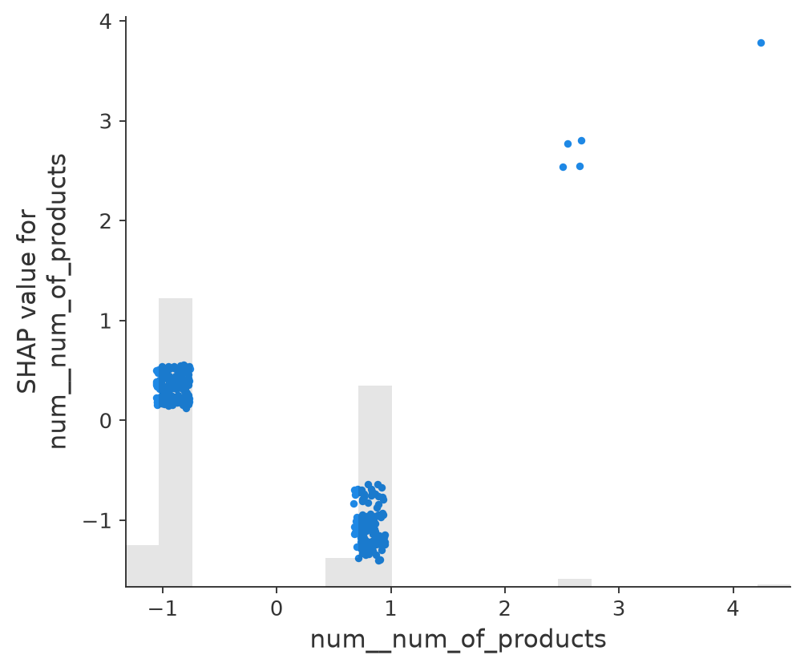

# Customer Churn & Retention Analytics

**An end-to-end banking churn analytics and decision-support project** combining SQL exploration, machine-learning model selection, explainability, top-K retention targeting, Tableau dashboards, and a deployed Streamlit application.

**[Try the live Streamlit app](https://customer-churn-retention-analytics-xjwwvpqydj26hofxpbqycm.streamlit.app/)** · **[View the GitHub repository](https://github.com/datasriram/Customer-Churn-Retention-Analytics)**

## Project overview

Banks with limited retention budgets need to know **which customers may churn and whom to prioritize for outreach**. This project analyzes customer behavior, compares classification models, scores churn risk, and ranks customers for a configurable outreach capacity. The app also illustrates the potential economics of a campaign under user-defined assumptions.

This is a **portfolio demonstration on a static educational banking dataset**, not a validated production banking system. Predicting churn is not the same as proving that contacting a customer will prevent it.

## Key results — updated XGBoost pipeline

| Metric | Held-out test result |
|---|---:|
| ROC-AUC | **0.8774** |
| Average precision (AP) | **0.7293** |
| Accuracy | 83.20% |
| Precision at selected threshold | 57.29% |
| Recall at selected threshold | 69.36% |
| F1-score | 0.6275 |
| Brier score | 0.0976 |
| **Precision@10%** | **85.50%** |
| Recall@10% | 41.91% |

- **Data:** 10,000 customer records; overall observed churn prevalence **20.38%**.
- **Split:** stratified 80% training / 20% test, random seed 42.
- **Operating threshold:** 0.28, selected by F1 on training-only out-of-fold predictions, then applied to the test set.
- **Confusion matrix:** TN 1,381; FP 211; FN 125; TP 283, with 408 churners in the 2,000-customer test set.
- **Outreach interpretation:** among the highest-risk 200 customers (top 10% of the test set), **171 actually churned**. Precision@10% = 85.5%, compared with approximately 20.4% churn prevalence.

These are historical hold-out benchmark metrics, **not prospective campaign outcomes**. This dataset had been used in earlier project experiments; the holdout should not be presented as fully independent of all past development decisions.

## Model selection: why XGBoost?

A new reproducible comparison used **five-fold stratified cross-validation**, preprocessing within each fold, and out-of-fold probability predictions from the training data. **Average precision** was the primary model-selection criterion; ROC-AUC, Brier score, and top-10% targeting performance provided supporting evidence.

| Candidate | OOF average precision | OOF ROC-AUC | OOF Brier score | OOF Precision@10% |
|---|---:|---:|---:|---:|
| **XGBoost** | **0.6983** | **0.8625** | **0.1022** | **82.62%** |
| Random Forest | 0.6702 | 0.8551 | 0.1217 | 80.50% |
| Logistic Regression | 0.4586 | 0.7628 | 0.1369 | 54.62% |
| Balanced Logistic Regression | 0.4488 | 0.7662 | 0.1963 | 54.25% |

**Decision:** XGBoost ranked customers best under the predetermined average-precision criterion for these tested configurations. This **does not** establish statistically significant superiority, optimal hyperparameters, or guaranteed performance on future customers. Standard and class-weighted Logistic Regression were retained as interpretable baselines; balanced Random Forest remains a competitive tree-based baseline.

The previous notebook and Tableau work used **Balanced Random Forest** as an earlier experimental approach. **The currently deployed model is XGBoost.** Do not mix the older Random Forest test metrics or priority segment counts with the updated pipeline's results.

## Data and leakage precautions

The cleaned modeling table uses 13 predictors: credit score, geography, gender, age, tenure, balance, product count, credit-card ownership, activity status, estimated salary, satisfaction score, card type, and points earned. The outcome is `exited`.

- Exclude `customer_id` and other identifying columns from training.
- Exclude the original raw-data `Complain` column because of potential target leakage.
- Impute missing numeric values, scale numeric variables, and one-hot encode categorical variables **inside** a scikit-learn pipeline, fitted separately within cross-validation folds.
- Select the model and threshold with **training data only**; use the holdout to report performance and diagnostics.
- A static dataset cannot establish true prediction-time availability of every variable or support temporal, prospective validation.

## Evaluation beyond accuracy

### Retention targeting at a fixed outreach capacity

The application scores customers and sorts them by descending estimated churn risk. A configurable contact budget selects the top *K* customers, independent of the classification threshold.

| Top fraction contacted | Customers | Actual churners captured | Precision@K | Recall@K |
|---:|---:|---:|---:|---:|
| 5% | 100 | 96 | 96.00% | 23.53% |
| 10% | 200 | 171 | 85.50% | 41.91% |
| 20% | 400 | 257 | 64.25% | 62.99% |
| 30% | 600 | 317 | 52.83% | 77.70% |
| 50% | 1,000 | 369 | 36.90% | 90.44% |



### Probability calibration

The held-out Brier score is **0.0976**. The reliability plot checks how predicted churn risk compares with observed churn rates across bins. It is a **diagnostic**, not proof of perfect calibration; the deployed scores have not undergone a separate calibration fit.



### Error and subgroup analysis

The evaluation records false positives and false negatives, and compares precision and recall by geography, gender, activity status, and product count. For example, the observed recall was **80.7% for Germany** versus **61.7% for France** on this test set. These subgroup estimates may be noisy, especially for small groups, and require more data before operational use.

## Explainability: permutation importance and SHAP

Two complementary approaches help interpret the XGBoost predictions:

**Permutation importance** measures the deterioration in held-out average precision when a feature is shuffled. Its leading original features were `num_of_products`, `age`, `is_active_member`, `balance`, and `geography`.



**TreeSHAP** explains individual model outputs and global contribution patterns. The SHAP reconstruction check reported a maximum absolute error of about **3.58 × 10^-7**. SHAP values here are contributions to **log-odds**, not percentage-point changes in churn probability. They describe model behavior, not causal effects.

The highest mean absolute SHAP contributions included **age (0.7995)**, **number of products (0.6543)**, **active membership (0.3902)**, and the one-hot encoded **Germany indicator (0.2516)**. Categorical SHAP contributions are shown on the **encoded feature** level.

**Global contribution ranking**



**Distribution of feature contributions**



**Example customer explanation**



**Feature-dependence diagnostics**





## Retention decision support and business economics

The Streamlit app lets an analyst upload customer records, score churn risk, group customers by risk, set an outreach capacity, rank customers, and export a CSV of predictions and priorities. Classification and targeting are separate decisions: **the F1-selected classification threshold is approximately 0.28**, while the app's descriptive high-risk band begins at **0.60**, and top-K outreach depends on contact capacity.

A scenario calculator estimates potential value using user-specified **cost per contact**, **value per retained customer**, and **assumed campaign effectiveness**. An earlier illustrative calculation produced a hypothetical net value of **₹98,500** at 30% outreach (600 of the 2,000 test customers), under ₹100/contact, ₹5,000/value per successfully retained customer, and 10% assumed effectiveness.

**This is not realized ROI.** It relies on unverified probability and treatment-response assumptions. A randomized controlled retention campaign would be needed to estimate whether outreach actually prevents churn and for whom.

## Application and analytics stack

```text
CSV customer data
     |
     v
Schema checks and sklearn preprocessing pipeline
     |
     v
Saved XGBoost model -> churn-risk scores
     |
     +--> classification using training-selected threshold
     +--> top-K ranking and outreach selection
     +--> hypothetical campaign economics
     +--> downloadable prioritized CSV

Offline evaluation -> model comparison, calibration,
feature importance, SHAP, subgroup diagnostics

SQL + original EDA -> Tableau descriptive/retention dashboards
```

**Live app:** [Customer Churn & Retention Intelligence](https://customer-churn-retention-analytics-xjwwvpqydj26hofxpbqycm.streamlit.app/)

**Tableau dashboards:** [Customer Churn Overview](https://public.tableau.com/app/profile/tummala.sriram/viz/Book1_17896808760300/CustomerChurnOverview) · [Churn Risk & Retention Prioritization](https://public.tableau.com/app/profile/tummala.sriram/viz/Book2_17896999140930/ChurnRiskRetentionPrioritization)

*Note: the existing Tableau retention dashboard reflects the earlier Random Forest experiment; it is not automatically refreshed from the deployed XGBoost model.*

## Repository guide

| Location | Purpose |
|---|---|
| `data/raw/`, `data/processed/` | Original and cleaned data; earlier scoring/reporting exports |
| `sql/` | SQLite setup and SQL churn analytics |
| `notebooks/customer_churn_analysis.ipynb` | Original EDA, imbalance comparisons, Random Forest experiments |
| `dashboard/` | Tableau dataset preparation and supporting documentation |
| `train_evaluate.py` | New cross-validated model comparison and saved XGBoost pipeline |
| `analyze_model.py` | Calibration, top-K evaluation, permutation importance, error and segment analyses |
| `shap_analysis.py` | XGBoost TreeSHAP verification and charts |
| `app.py` | Streamlit risk scoring and retention decision-support UI |
| `outputs/v2/` | Current evaluation metrics, plots, metadata and saved model |

## Run locally

Use a Python environment compatible with the versions in `requirements.txt` and with the committed `joblib` model artifact. For the current saved model, the development environment used Python **3.14**, scikit-learn **1.9.1**, and XGBoost **3.4.1**. Never load untrusted `joblib` files.

```bash
python -m pip install -r requirements.txt
python -m streamlit run app.py
```

To regenerate the current experimental outputs, rather than just run the existing deployed artifact:

```bash
python train_evaluate.py
python analyze_model.py
python shap_analysis.py
```

Changing dependency versions, seeds, data, or modeling code may change outputs. The Streamlit deployment must include all referenced images and `outputs/v2/churn_model.joblib`.

## Limitations and future work

- **Static sample:** no time-stamped behavioral history or future-horizon validation; train/test are stratified random splits, not time splits.
- **Historical development exposure:** the same educational dataset was used in earlier project iterations; the reported holdout is not evidence of independent external generalization.
- **Operational drift:** no validated monitoring on incoming production data.
- **Calibration:** diagnostic plots and Brier score are reported, but probability recalibration was not separately fitted and independently tested.
- **Fairness and subgroup stability:** observed segment disparities require deeper assessment, especially where groups are small.
- **Business impact:** targeting simulations do not establish causal retention uplift; intervention effectiveness requires an experiment.
- **Engineering:** automated unit/integration tests and CI can be added in a later iteration.

## Technology

Python · Pandas · NumPy · scikit-learn · XGBoost · Joblib · Matplotlib · Streamlit · SQLite / SQL · Tableau
